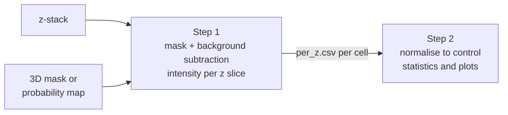

# Fluorescence intensity quantification in 3D masks

Generic Jupyter notebooks that measure fluorescence intensity inside 3D cell masks, slice by slice, and compare
conditions. They work with any number of channels, conditions and experiments. The mask can be the whole cell or a
shell under the cell surface, such as the cortex.

They were generalised from the analysis of cortical actin and phospho-myosin in Dar, Tesoro-Moreno, Palaia et al.
*Caging of membrane-to-cortex attachment proteins can trigger cellular symmetry breaking* (Figure S8E, F, H, I).

## Pipeline



| Notebook | What it does |
|---|---|
| [`1_quantify_intensity_in_3D_masks.ipynb`](1_quantify_intensity_in_3D_masks.ipynb) | z-stack and mask → `analysis_mask.tif`, `per_z.csv` and `qc_montage.png` for each cell |
| [`2_compare_conditions.ipynb`](2_compare_conditions.ipynb) | `per_z.csv` of all cells → per-cell table, statistics and plots |

## Method

**Step 1, for each cell:**

1. Threshold the mask or probability map.
2. Fill holes in each z slice and remove 3D objects smaller than `MIN_COMPONENT_VOXELS`.
3. Build the measurement mask. In each z slice, a 2D distance transform gives the foreground pixels within
   `SHELL_THICKNESS_PX` of the edge of the cell. With `SHELL_THICKNESS_PX = None`, the whole cleaned foreground is used.
4. Subtract background from each channel: the mean intensity of all voxels outside the cleaned foreground, over the
   whole stack. Background-subtracted intensities can be negative.
5. Measure the number of mask pixels and the mean and SD of each channel in each z slice.

**Step 2, for each dataset:**

1. **Per-cell values:** mean intensity is the mean over z slices of the slice means, skipping slices with no mask
   pixels; pixel number is the total number of mask pixels.
2. **Normalisation:** each value is divided by the mean of all control cells of the same dataset, pooled over the
   experiments.
3. **Statistics:** Shapiro–Wilk per group, then a two-sided Mann–Whitney U test of each condition against the control.
4. **Plots:** violin, box and per-cell points for each measure, and mean ± SEM along z for each channel.

## Installation

```bash
git clone https://github.com/diz-lab/Caging-of-membrane-to-cortex-attachment-proteins-can-trigger-cellular-symmetry-breaking-.git
cd Caging-of-membrane-to-cortex-attachment-proteins-can-trigger-cellular-symmetry-breaking-/3d-mask-intensity-quantification
pip install -r requirements.txt
```

Tested with Python 3.10, numpy 2.2, pandas 2.3, scipy 1.15, matplotlib 3.10, seaborn 0.13 and tifffile 2025.5.

## Input data

Use one folder per condition and one sub-folder per experiment, with the same names for images and masks:

```
data/
├── 1_Raw/<condition>/<experiment>/<cell>.tif
└── 2_Segmentations/<condition>/<experiment>/<cell><MASK_SUFFIX>
```

- **z-stacks** have axes (z, c, y, x), or (z, y, x) for one channel.
- **Masks** have axes (z, y, x), the same size as the z-stack. Probability maps (0–1) and binary masks (0/1 or 0/255)
  both work; any 3D segmentation can be used.
- **Experiment names** ending in `_Exp<N>` are recorded as `<N>`; otherwise the whole folder name is used.

Images and results stay out of git.

## Usage

### Step 1: `1_quantify_intensity_in_3D_masks.ipynb`

Edit the settings in section 2, then run all cells. Cells that already have all output files are skipped unless
`OVERWRITE = True`.

| Setting | Default | Meaning |
|---|---|---|
| `RAW_DIR`, `MASK_DIR`, `OUTPUT_DIR` | `data/1_Raw`, `data/2_Segmentations`, `data/3_Processed` | Folders |
| `MASK_SUFFIX` | `_foreground_pmaps.tif` | Mask file name after the cell name |
| `GATE_SUFFIX` | None | Optional second map that further restricts the mask |
| `CHANNELS` | 3 example channels | Channel name → index in the z-stack |
| `QC_CHANNEL` | `channel_1` | Channel shown in the QC montage |
| `MASK_THRESHOLD` | 0.5 | Threshold on the mask |
| `MIN_COMPONENT_VOXELS` | 5,000 | Smaller 3D objects are removed |
| `SHELL_THICKNESS_PX` | 10 | Shell thickness in pixels, or None for the whole mask |

Output, in `OUTPUT_DIR/<condition>/<experiment>/<cell>/`:

| File | Content |
|---|---|
| `analysis_mask.tif` | The 3D mask used for the measurement (0/255) |
| `per_z.csv` | One row per z slice: `cell`, `z`, `n_pixels`, then `<channel>_mean` and `<channel>_std` |
| `qc_montage.png` | Channel, cleaned foreground and mask overlay at 4 z slices |

### Step 2: `2_compare_conditions.ipynb`

Edit the settings in section 2, then run all cells.

| Setting | Meaning |
|---|---|
| `DATASETS` | For each dataset: the output folder of step 1, and condition folder → short label |
| `CONTROL`, `ORDER` | Label of the control, and the plotting order |
| `LABELS`, `PALETTE` | Names and colours on the plots |
| `Z_YLIM` | Y limits of the plots along z, or None |
| `OUTPUT_DIR` | Where tables and plots are written |

Output:

| File | Content |
|---|---|
| `per_cell_summary.csv` | One row per cell: mean intensities, pixel number and normalised values |
| `statistics.csv` | Group sizes, means, Shapiro–Wilk p-values, Mann–Whitney U and p for each measure and condition |
| `<dataset>_<measure>_normalized.svg` | Violin plot of the normalised values |
| `<dataset>_<channel>_along_z.svg` | Mean ± SEM per z slice |

## Notes

- **The shell is built per z slice.** It follows the edge of the cell in each slice, so the top and bottom slices of a
  cell get a ring rather than a filled cap.
- **Whole-stack background.** One background value per channel is used for the whole stack, so it does not correct for
  intensity changes along z.
- **Statistical unit.** Each cell counts as one sample, pooled over experiments.
- **Multiple comparisons.** With more than two conditions, each is tested against the control with no correction.

## Reproducing the manuscript results

These settings reproduce Figure S8 from the deposited BioStudies dataset:

| Setting | Live cells | Fixed cells |
|---|---|---|
| `CHANNELS` | `{'actin': 2, 'linker': 1, 'myosin': 0}` | `{'actin': 0, 'linker': 1, 'myosin': 2}` |
| `QC_CHANNEL` | `actin` | `actin` |
| Other step 1 settings | defaults | defaults |
| Step 2 control folder → label | `delFBS_iMC_6FP_NI_delFBS` → `Ctrl` | `delFBS_NI_iMC_6FP` → `Ctrl` |
| Step 2 treated folder → label | `delFBS_MBCD5mM_NI_iMC_6FP` → `MBCD` | `delFBS_MBCD5mM_NI_iMC_6FP` → `MBCD` |

The pixel size is 0.065 µm, so the 10-pixel shell is 0.65 µm. In the live cells, the `myosin` channel holds the AF488
NHS ester negative stain; the column name comes from the original analysis.

**Checked against the published results:**

- **Step 1** was run on 4 cells, one per condition in the live and fixed datasets. `per_z.csv` and the mask are
  identical to the deposited files.
- **Step 2** was run on all 268 deposited cells. The per-cell values and statistics are identical to the original
  Figure S8 notebook:

| Panel | Dataset | Measure | n (control / MβCD) | U | p |
|---|---|---|---|---|---|
| S8E | live | actin | 68 / 71 | 1283 | 1.9 × 10⁻⁶ |
| S8E | fixed | actin | 58 / 71 | 2855 | 1.7 × 10⁻⁴ |
| S8F | live | pixel number | 68 / 71 | 926 | 3.7 × 10⁻¹⁰ |
| S8F | fixed | pixel number | 58 / 71 | 961 | 2.0 × 10⁻⁷ |
| S8H | fixed | phospho-myosin | 58 / 71 | 1761 | 0.16 |

The whole-cell mask, binary masks, single-channel stacks and more than two conditions were tested on synthetic data.

## Source

Generalised from `Cortex_Quantification_Live_MBCD.ipynb`, `Cortex_Quantification_Fixed_MBCD.ipynb` and
`Figure_S8_Live_vs_Fixed_MBCD.ipynb`, deposited with the dataset. The calculations are unchanged. These parts are new:

- settings for channels, conditions and datasets;
- the optional whole-cell mask;
- support for single-channel stacks.

## License

MIT, see [LICENSE](LICENSE).

## Author

Ruben Tesoro Moreno

Code development was supported by Claude (Anthropic).

