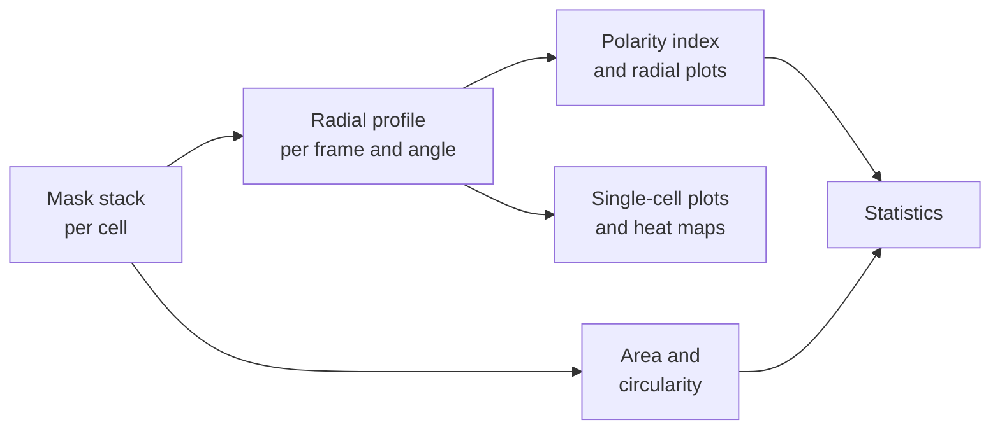

# Dynamic micropatterning analysis

Jupyter notebook that measures how single cells spread and polarise after release from a micropattern. Starting from
one binary mask stack per cell, it computes radial profiles over time, the polarity index, cell area and circularity,
and makes all the tables, plots and statistics.

Part of the analysis for Dar, Tesoro-Moreno, Palaia et al. *Caging of membrane-to-cortex attachment proteins can
trigger cellular symmetry breaking* (Figure 7A–D).

## Pipeline



## Method

- **Radial profiles:** the origin is the centroid of the mask in the first frame and stays fixed for the whole movie.
  For each of 360 angles, the radial distance is the furthest mask pixel along the ray.
- **Alignment:** to compare cells, the profiles of each cell are rotated together so that the shortest ray of a
  reference frame points to 90°.
- **Polarity index:** for each cell and frame, the distances are divided by their sum over the 360 angles, and
  polarity index = (max − min) / (max + min) of these normalised distances.
- **Area and circularity:** area is the number of mask pixels × pixel size²; circularity is 4π·area / perimeter²,
  with the perimeter from the mask contours.
- **Statistics:**
  - polarity index at 10 min: one-way ANOVA with Tukey's post hoc test, and a two-sided Mann–Whitney U test for
    6FP E11 NI vs 11FP B10 Dox;
  - area: ANOVA, Shapiro–Wilk, Levene, Tukey and Welch's t-test.

## Installation

```bash
git clone https://github.com/diz-lab/Caging-of-membrane-to-cortex-attachment-proteins-can-trigger-cellular-symmetry-breaking-.git
cd Caging-of-membrane-to-cortex-attachment-proteins-can-trigger-cellular-symmetry-breaking-/dynamic-micropatterning-analysis
pip install -r requirements.txt
```

Tested with Python 3.10, numpy 2.2, pandas 2.3, scipy 1.15, matplotlib 3.10, seaborn 0.13, scikit-image 0.25,
tifffile 2025.5 and statsmodels 0.14.

## Input data

One TIFF per cell, in one sub-folder per experiment:

```
<MASK_FOLDER>/<condition>_Exp<N>/<cell>_cleaned_mask.tif     axes (t, y, x); 0 = background, above 0 = cell
```

- The file name must contain one of the names in `CONDITIONS`, which is how each cell gets its condition.
- The masks and raw movies of the paper are deposited in BioStudies. They are not included in this repository.

## Usage

Open `Dynamic_Micropatterning_Analysis.ipynb`, check the **Settings** cell, and run all cells. The full analysis of
420 cells takes about 6 min.

| Setting | Value | Meaning |
|---|---|---|
| `MASK_FOLDER` | `../2_Segmentations` | Folder with the masks |
| `OUTPUT_FOLDER` | `output` | Where the tables and plots are written |
| `PIXEL_SIZE_UM`, `FRAME_INTERVAL_MIN` | 0.325, 2 | Pixel size and time between frames |
| `N_ANGLES`, `ALIGN_ANGLE`, `REFERENCE_FRAME` | 360, 90°, 20 | Rays per cell, and the alignment of the profiles |
| `SINGLE_CELL_FRAMES`, `SINGLE_CELL_REFERENCE_FRAME`, `SINGLE_CELL_BINS` | 15, 14, 24 | Single-cell plots: frames 0–14, aligned on frame 14, 15° bins |
| `MAKE_SINGLE_CELL_PLOTS` | True | 4 plots per cell, about 1,700 files |
| `MAKE_ANIMATION_FRAMES` | False | Frames for the 3 movies |
| `PMAP_FOLDER` | None | Probability maps, only for remaking the masks (section 9) |
| `EXAMPLE_CELLS` | 2 cells of the paper | Cells for the example plots; change these for other data |
| `CONDITIONS`, `POLARITY_CONDITIONS`, `BOX_ORDER` and the colours | conditions of the paper | Conditions, their order and colours in the plots |

## Output

All output goes into `OUTPUT_FOLDER`:

| Location | Content |
|---|---|
| `All_DataFrame_SINGLETIMEPOINTS.csv` | Radial distance per cell, frame and angle |
| `All_DataFrame.csv` | Maximum spread per cell and angle |
| `All_DataFrame_SPREADAREA.csv` | Mask area per cell, frame and 10° bin |
| `Single_Cell_Plots/` | Radial profiles, maximum spread and spread over time, per cell (frames 0–14) |
| `Example_Cells/` | The same plots for the example cells over all 31 frames, plus the mask outlines |
| `Average_Heat_Maps/` | Mean and SD of the radial distance per angle and frame, per condition |
| `Polarity_Index/` | Polarity index tables, plots over time, violin plot and statistics at 10 min, radial plots |
| `Area_Circularity/` | Area and circularity per frame, plots over time, box plots and statistics |

## Segmentation

Masks were made from the phase-contrast channel with a trained PlantSeg 3D U-Net, using time as the third dimension.
Section 9 of the notebook has the cleaning step: Otsu threshold, largest object, removal of small objects and objects
touching the border, hole filling and morphological closing. It runs only if `PMAP_FOLDER` is set. The trained models
are not in this repository.

## Notes

- **Empty first frame:** a cell with an empty mask in its first frame has no origin and is left out of the radial
  analysis. It stays in the area and circularity measurements.
- **Empty later frames:** these give NaN in the radial and circularity measurements but an area of 0, which is
  included in the mean area over time.
- **Pooled frames:** the area statistics pool two frames (5 and 15, or 5 and 10), so most cells count twice.

## Checked against the published results

The notebook was rerun on the 420 deposited masks, without the single-cell plots:

- The three `All_DataFrame*.csv` tables are identical to the deposited ones.
- The polarity index at 10 min reproduces the published statistics:
  - cells: 90, 57, 67 and 58 (6FP NI, CA-moesin Dox, 6FP Dox, 11FP Dox);
  - means: 0.345, 0.396, 0.524 and 0.586;
  - ANOVA: F = 51.07, p = 3.9 × 10⁻²⁶;
  - Mann–Whitney U: U = 624.5, p = 6.3 × 10⁻¹⁵.

## Source

`Dynamic_Micropatterning_Analysis.ipynb` is the notebook deposited with the dataset, unchanged.

## License

MIT, see [LICENSE](LICENSE).

## Author

Ruben Tesoro Moreno

Code development was supported by Claude (Anthropic).

