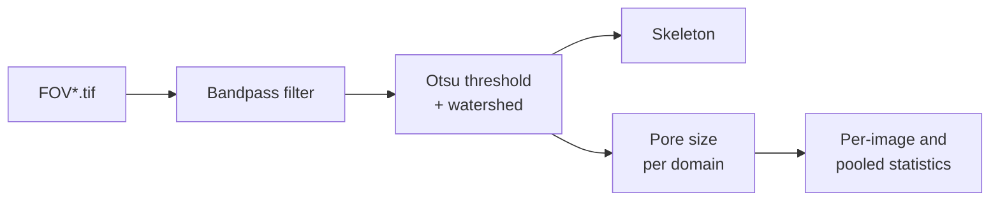

# Actin cortex pore size analysis

Python script that measures the size of the pores (domains) in the actin cortex. It bandpass-filters each image,
segments the pores with a watershed, skeletonizes the actin network, and measures the area and size of every pore.
The approach follows Eghiaian et al., *Biophysical Journal* 108(6), 2015.

## Pipeline



1. **Bandpass filter:** the difference of two Gaussian blurs, `LOW_SIGMA_NM` minus `HIGH_SIGMA_NM`, normalised to 0–1.
2. **Segmentation:**
   - an Otsu threshold separates the filaments (bright) from the pores (dark);
   - a distance transform of the pores gives local maxima, which seed a watershed on the inverted distance map;
   - domains smaller than `MIN_DOMAIN_SIZE_NM2` are removed.
3. **Skeleton:** the filament mask thinned to 1-pixel lines, used for display.
4. **Pore size:** for each domain, area (nm²), pore size = √area (nm), major and minor axes, aspect ratio,
   eccentricity and perimeter.
5. **Statistics:**
   - per image: mean, SD, median, mode, minimum and maximum pore size;
   - pooled over all images: a histogram from 0 to 400 nm with a Gaussian curve from the mean and SD.

## Installation

```bash
git clone https://github.com/diz-lab/Caging-of-membrane-to-cortex-attachment-proteins-can-trigger-cellular-symmetry-breaking-.git
cd Caging-of-membrane-to-cortex-attachment-proteins-can-trigger-cellular-symmetry-breaking-/pore-size-analysis
pip install -r requirements.txt
```

Tested with Python 3.10, numpy 2.2, pandas 2.3, scipy 1.15, scikit-image 0.25, tifffile 2025.5 and matplotlib 3.10.

## Usage

Put the images, named `FOV1.tif`, `FOV2.tif`, …, in one folder, then run:

```bash
python pore_size_analysis.py
```

The script asks for the input folder and the output folder. The other settings are at the top of the file:

| Setting | Value | Meaning |
|---|---|---|
| `PIXEL_SIZE_NM` | 107.5 | Pixel size of the images (nm) |
| `LOW_SIGMA_NM` | 10 | Bandpass: removes noise smaller than this (nm) |
| `HIGH_SIGMA_NM` | 500 | Bandpass: removes background variation larger than this (nm) |
| `WATERSHED_COMPACTNESS` | 0.001 | 0 gives a classic watershed; small values give more compact domains |
| `MIN_DOMAIN_SIZE_NM2` | 500 | Domains smaller than this are discarded (nm²) |
| `SHOW_PLOTS` | True | Set to False to run without opening figure windows |

Multi-page TIFFs are reduced to their first frame.

## Output

All output goes into the output folder:

| Folder | Files |
|---|---|
| `1_filtered/` | `FOV<n>_filtered.tif`: bandpass-filtered image (16-bit) |
| `2_segmented/` | `FOV<n>_labels.tif`: one label per pore; `FOV<n>_binary.tif`: filament mask |
| `3_skeleton/` | `FOV<n>_skeleton.tif` |
| `4_overlay/` | `FOV<n>_overview.png`: raw image, filtered image, domains with skeleton, and pore size histogram |
| `5_results/` | `FOV<n>_domains.csv`: one row per pore; `summary_per_image.csv`; `all_domains_pooled.csv`; `pore_size_histogram.png` |

## Notes on the settings

The size settings come from the reference paper, which used AFM images with 15 nm pixels. At 107.5 nm per pixel:

- **The noise filter does almost nothing.** `LOW_SIGMA_NM = 10` is 0.09 px.
- **No small domains are removed.** `MIN_DOMAIN_SIZE_NM2 = 500` rounds down to 0 px, because one pixel is already
  11,556 nm². Single-pixel domains are kept and counted.
- **The smallest possible pore is one pixel**, i.e. 107.5 nm. The reference value printed at the end of a run
  (96.5 ± 72.2 nm) is below that, so it can't be compared directly.
- **Pores touching the image border are included,** so their sizes are cut off by the edge.

## Source

`pore_size_analysis.py` is `PoreSizeAnalysis_Watershed_Clark.docx`, copied as text without changes.

## License

MIT, see [LICENSE](LICENSE).

## Author

Srishti Dar

Code development was supported by Claude (Anthropic).

